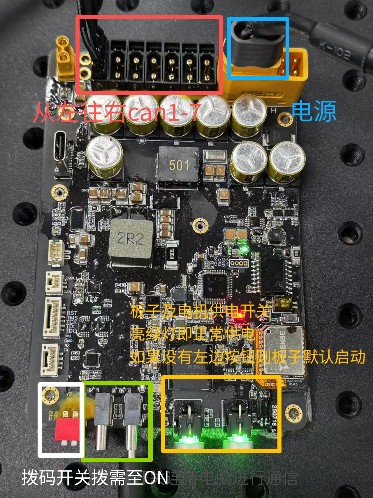
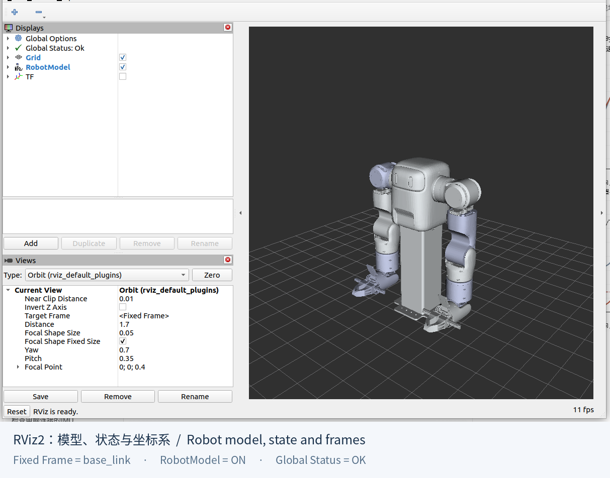
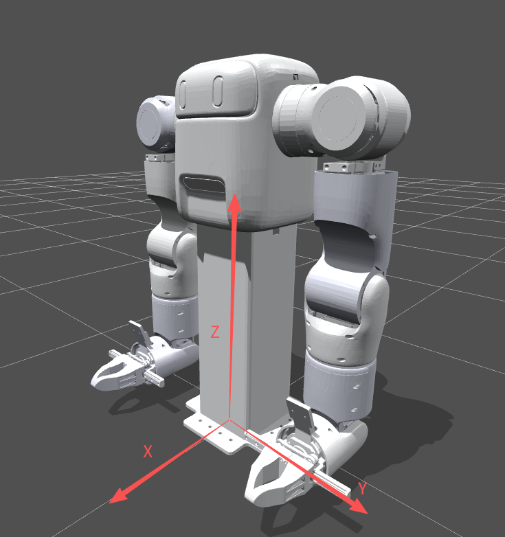
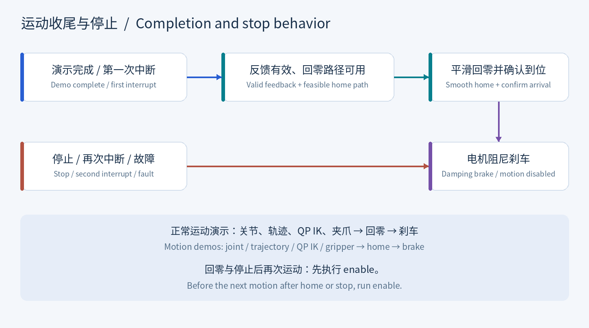
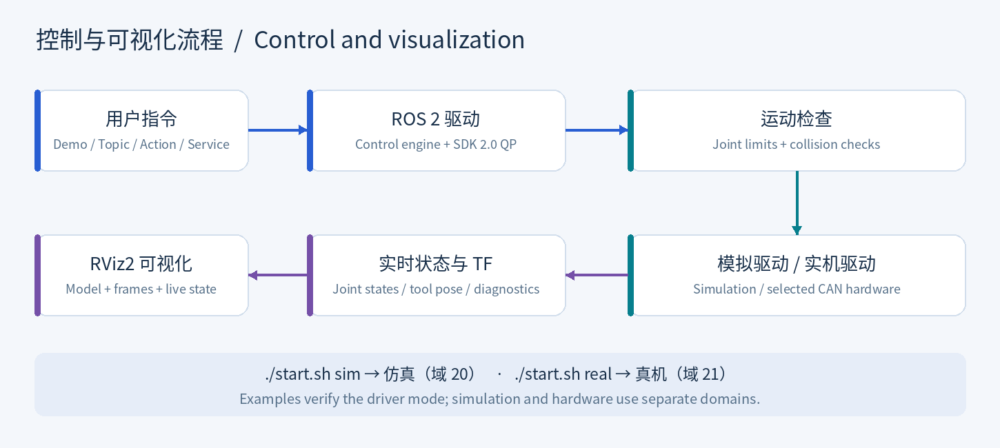

# T701-HT ROS 2 SDK

[English](README_EN.md)

本 SDK 提供真机控制、RViz2 可视化、关节与轨迹例程、QP 逆运动学、夹爪、回零和阻尼刹车。

**操作时只需选择下面的一章，按顺序执行：**

- [首次安装与构建](#1-首次安装与构建)：新电脑使用前完成一次。
- [真机使用](#2-真机使用)：连接机械臂，全部命令集中在这一章。
- [仿真使用](#3-仿真使用)：不连接机械臂，全部命令集中在这一章。
- [接口参考](#4-接口参考)、[模型与保护规则](#5-模型与保护规则)、[项目结构](#6-项目结构与常见问题)：开发和查阅时使用。

在包含 `start.sh` 的 **SDK 根目录**打开终端。本文所有命令都从这个目录执行。

## 1. 首次安装与构建

### 1.1 系统依赖

使用 Ubuntu 22.04、ROS 2 Humble 和 Python 3.10。ROS 软件源按 [ROS 2 Humble 官方安装说明](https://docs.ros.org/en/humble/Installation/Ubuntu-Install-Debs.html)配置，然后安装：

```bash
sudo apt update
sudo apt install python3-venv python3-pip python3-pytest \
  python3-colcon-common-extensions python3-numpy python3-scipy python3-yaml \
  python3-jinja2 python3-joblib \
  ros-humble-desktop ros-humble-control-msgs ros-humble-diagnostic-msgs \
  ros-humble-pinocchio ros-humble-hpp-fcl
```

ROS 2 和 RViz2 由 `ros-humble-desktop` 提供；Pinocchio 和 FCL 用于正运动学、雅可比及网格碰撞检查。模拟和实机均使用这些模型库。

### 1.2 创建 Python 环境并构建

```bash
python3.10 -m venv --system-site-packages .venv
.venv/bin/python -m pip install \
  'numpy>=1.23,<2' 'scipy>=1.9,<2' 'PyYAML>=6,<7' 'osqp>=1,<2' pytest
./build.sh
```

使用 apt 提供的 Pinocchio/FCL 和 NumPy 1.x。`python_wheels/` 提供部分 x86_64 Python 3.10 依赖，完整安装仍需上述系统依赖和 Python 依赖。真机电机库安装见下方“真机使用”。

`build.sh` 和 `start.sh` 会加载 ROS 2 Humble 与本工作空间，并清除继承的 Python/ROS 路径；使用 SDK 自带的 `.venv`，无需激活 Conda。复制到另一台电脑或移动目录后，在新目录重新创建 `.venv` 并运行 `./build.sh`。

## 2. 真机使用

本章命令控制实际机械臂，统一使用 `real` 前缀。先完成公共安装，再按本章顺序连接和操作。每次选择一个功能执行，不需要把整章所有命令连续粘贴运行。

### 2.1 安装电机库与接线

只在首次使用真机时执行本节。

Linux x86_64、Python 3.10：

```bash
.venv/bin/python -m pip install hardware_wheels/hightorque_robot-1.2.0-cp310-cp310-linux_x86_64.whl
```

Linux ARM64、Python 3.10：

```bash
.venv/bin/python -m pip install hardware_wheels/hightorque_robot-1.0.0-cp310-cp310-linux_aarch64.whl
```

按电脑架构选择一条命令。架构和原生库说明见 [hardware_wheels/README.md](hardware_wheels/README.md)。



通信板图示标出了电源、CAN 与 USB 通信连接位置。

左臂逻辑 **CAN1**，右臂逻辑 **CAN2**。驱动根据板子序列号和 USB 接口身份选择串口，自动处理 `/dev/ttyACM*` 枚举顺序变化。

相关配置：

```text
src/t701_ht_description/config/serial_binding.yaml
src/t701_ht_description/config/T701-HT_left.yaml
src/t701_ht_description/config/T701-HT_right.yaml
src/t701_ht_description/config/motor_param/
```

查看串口和用户组：

```bash
ls -l /dev/ttyACM*
id -nG
```

将当前用户加入串口权限组后，退出当前桌面登录并重新登录：

```bash
sudo usermod -aG dialout "$USER"
```

原 Python SDK 与 ROS 2 SDK 分别运行；同一时间只用一套程序控制同一块通信板。

### 2.2 终端 A：启动驱动

在 SDK 根目录打开终端 A，启动双臂和 RViz2：

```bash
./start.sh real arms:=dual
```

**保持终端 A 运行，后续操作在新开的终端 B 中执行。** 终端 B 也要位于 SDK 根目录。真机启动后只读取反馈，运动尚未使能。

只使用一条机械臂时，先关闭原驱动，再从下面两条命令中选择一条启动：

左臂：

```bash
./start.sh real arms:=left
```

右臂：

```bash
./start.sh real arms:=right
```

关节往返和多点轨迹会驱动 `arms` 选中的机械臂；`--side` 用于选择 IK 或夹爪操作侧。双臂互撞检查使用 `arms:=dual`。

### 2.3 在终端 B 读取状态

**后面的状态和功能命令都在终端 B 执行，终端 A 保持运行。**

只读取状态，持续 5 秒：

```bash
./start.sh real demo --mode state --duration 5
```

读取一次电机位置、速度和力矩：

```bash
./start.sh real topic echo /t701_ht/motor_states --once
```

查看左右末端位姿及诊断；单臂模式只查询已启动侧：

```bash
./start.sh real topic echo /t701_ht/left_tool_pose --once
./start.sh real topic echo /t701_ht/right_tool_pose --once
./start.sh real topic echo /diagnostics --once
```

### 2.4 关节往返

所选侧 J1 在当前姿态基础上往返，幅度 0.10 rad，运动时间 5 秒，结束后回零刹车：

```bash
./start.sh real demo --mode enable
./start.sh real demo --mode joint --duration 5 --amplitude 0.10
```

要只动左臂或右臂，在第一个终端分别以 `arms:=left` 或 `arms:=right` 启动驱动；`arms:=dual` 时两臂同步执行，右侧 J1 反号。

### 2.5 多点轨迹

在当前姿态基础上执行四段小幅轨迹，运动时间 8 秒，结束后回零刹车：

```bash
./start.sh real demo --mode enable
./start.sh real demo --mode trajectory --duration 8 --amplitude 0.10
```

`--amplitude` 范围为大于 0、最多 0.20 rad；`--duration` 为正数。这里的时间是轨迹运动时间，不包含结束后的回零时间。

### 2.6 QP 逆运动学

左臂演示：

```bash
./start.sh real demo --mode enable
./start.sh real demo --mode ik --side left
```

右臂演示：

```bash
./start.sh real demo --mode enable
./start.sh real demo --mode ik --side right
```

演示根据当前姿态生成一个附近的末端位姿，将该位姿交给 QP 求解，监测末端到位后回零刹车。在双臂模式中，另一臂保持当前位置。

### 2.7 夹爪控制

左夹爪目标为 0.4 rad：

```bash
./start.sh real demo --mode enable
./start.sh real demo --mode gripper --side left --gripper 0.4
```

右夹爪目标为 0.4 rad：

```bash
./start.sh real demo --mode enable
./start.sh real demo --mode gripper --side right --gripper 0.4
```

`--gripper` 使用夹爪电机角度，范围为 `[-0.2, 2.2]` rad。演示下发夹爪目标后默认观察 5 秒，再调用回零；所选机械臂和夹爪回到零位后进入阻尼刹车。使用 `--duration` 调整观察秒数，例如 `--duration 8`。

### 2.8 回零

```bash
./start.sh real demo --mode enable
./start.sh real demo --mode home
```

回零包含驱动所选机械臂的七个关节和夹爪。演示确认关节到位、速度降低且驱动进入 `braked` 后结束。

### 2.9 立即停止

```bash
./start.sh real demo --mode stop
```

立即请求电机阻尼刹车，控制进入禁用状态。该命令不执行回零路径。

### 2.10 中断与退出

关节、轨迹、IK、夹爪例程完成后，会自动回零并进入阻尼刹车。下一次运动前，先执行：

```bash
./start.sh real demo --mode enable
```

运动中在终端 B 按第一次 **Ctrl+C**，请求结束当前运动并回零。终端 A 的驱动继续完成收尾。要关闭整个系统，在终端 A 按 **Ctrl+C**；反馈有效且回零路径通过检查时，回零刹车后退出。再次中断立即请求刹车。

直接发布话题或使用轨迹 action 后，目标完成会保持终点，需要回零时执行本章的回零命令。

### 2.11 可视化、无窗口与远程使用

正常启动会一起打开 RViz2。Fixed Frame 设置为 `base_link`；勾选 **TF** 查看坐标系，**RobotModel → Collision Enabled** 查看碰撞网格。真机画面随实际关节反馈更新。

没有图形桌面时，在终端 A 只启动驱动：

```bash
./start.sh real arms:=dual rviz:=false
```

已有驱动运行时，在有桌面的终端只打开 RViz2：

```bash
./start.sh real run rviz2 rviz2 -d src/t701_ht_ros2/config/t701_ht.rviz
```

两台电脑分别运行驱动和 RViz2 时，两边先允许局域网通信，再分别运行上面两条命令；只启动一个驱动：

```bash
export ROS_LOCALHOST_ONLY=0
```

本章所有终端均使用 `real` 前缀，默认通信域为 **21**。遇到 GLX/OpenGL 错误，关闭原驱动后，用软件渲染重新启动：

```bash
T701_HT_SOFTWARE_RENDERING=1 ./start.sh real
```

### 2.12 标准 ROS 指令（进阶）

普通使用可直接使用上面的例程；需要从自己的程序接入时，使用本节接口。

<details>
<summary>展开：关节目标、轨迹 action、QP 位姿、夹爪和服务</summary>

#### 单臂关节目标

先在第一个终端启动左臂驱动：

```bash
./start.sh real arms:=left
```

在第二个终端发送完整七轴目标，默认 2 秒平滑过渡：

```bash
./start.sh real demo --mode enable
./start.sh real topic pub --once /t701_ht/joint_command sensor_msgs/msg/JointState \
  '{name: [left_joint1, left_joint2, left_joint3, left_joint4, left_joint5, left_joint6, left_joint7], position: [0.10, 0, 0, 0, 0, 0, 0]}'
```

右臂驱动使用 `arms:=right`，名称改为 `right_joint1`～`right_joint7`。

#### 双臂关节目标

在 `arms:=dual` 的驱动中发送完整 14 轴目标：

```bash
./start.sh real demo --mode enable
./start.sh real topic pub --once /t701_ht/joint_command sensor_msgs/msg/JointState \
  '{name: [left_joint1, left_joint2, left_joint3, left_joint4, left_joint5, left_joint6, left_joint7, right_joint1, right_joint2, right_joint3, right_joint4, right_joint5, right_joint6, right_joint7], position: [0.10, 0, 0, 0, 0, 0, 0, -0.10, 0, 0, 0, 0, 0, 0]}'
```

关节名称允许重排，每次命令必须包含所选侧的全部关节；不能重复、遗漏或多填。`/joint_states` 的 URDF 名称与坐标不能直接用作这里的电机命令。

#### 标准轨迹 action

以下示例使用 `arms:=left`，依次在第 2、4、6 秒到达三个目标：

```bash
./start.sh real demo --mode enable
./start.sh real action send_goal /t701_ht/follow_joint_trajectory \
  control_msgs/action/FollowJointTrajectory \
  '{trajectory: {joint_names: [left_joint1, left_joint2, left_joint3, left_joint4, left_joint5, left_joint6, left_joint7], points: [{positions: [0.10, 0, 0, 0, 0, 0, 0], time_from_start: {sec: 2}}, {positions: [-0.10, 0, 0, 0, 0, 0, 0], time_from_start: {sec: 4}}, {positions: [0, 0, 0, 0, 0, 0, 0], time_from_start: {sec: 6}}]}}' \
  --feedback
```

在运行 `action send_goal` 的终端按 **Ctrl+C**，客户端发送取消请求；驱动结束原轨迹并请求回零。继续查看 `/diagnostics` 和实际状态，直到回零刹车完成。

轨迹格式要求：

- 每个目标包含 1～2000 个点，总时长最多 300 秒。
- `time_from_start` 严格递增；可选的首个 0 秒点需与当前位置一致。
- 每点填写所选侧全部关节位置；速度要么不填，要么完整填写。末点速度为零。
- 使用零时间戳立即执行；不填显式加速度、力矩、自定义容差或多自由度轨迹。
- 运动采用分段五次插值，并检查位置、速度、加速度和碰撞路径；同时只执行一个运动任务。

#### QP 末端目标

位姿在 `base_link` 坐标系中表达，位置单位为 m，四元数顺序为 x、y、z、w。四元数需归一化，范数误差不超过 `1e-3`。

以下示例适用于当前模型从零位到左 J1 约 0.06 rad 对应的末端目标，可用于左臂或双臂驱动。先回零，再使能并发送目标：

```bash
./start.sh real demo --mode enable
./start.sh real demo --mode home
./start.sh real demo --mode enable
./start.sh real topic pub --once /t701_ht/left_target_pose geometry_msgs/msg/PoseStamped \
  '{header: {frame_id: base_link}, pose: {position: {x: -0.025971851, y: 0.185, z: 0.068147883}, orientation: {x: 0.0, y: 0.029995500, z: 0.0, w: 0.999550034}}}'
```

通过下面的命令查看到位状态；完成后按本章的“回零”操作：

```bash
./start.sh real topic echo /t701_ht/left_tool_pose --once
./start.sh real topic echo /diagnostics --once
```

右臂需要使用右臂对应的目标坐标，不能只把上面左臂示例的话题名换成 `/t701_ht/right_target_pose`。一般操作直接使用本章的右臂 IK 例程。驱动按关节限位、速度、加速度及几何检查约束 QP；未收敛、不可达或碰撞阻挡通过诊断状态报告。

#### 直接夹爪目标

```bash
./start.sh real demo --mode enable
./start.sh real topic pub --once /t701_ht/left_gripper std_msgs/msg/Float64 '{data: 0.4}'
```

右侧改用 `/t701_ht/right_gripper`。直接话题只设置夹爪目标；需要自动回零的完整演示使用本章的“夹爪控制”。

#### 回零、停止与使能服务

```bash
./start.sh real service call /t701_ht/home std_srvs/srv/Trigger '{}'
./start.sh real service call /t701_ht/stop std_srvs/srv/Trigger '{}'
./start.sh real service call /t701_ht/set_enabled std_srvs/srv/SetBool '{data: true}'
./start.sh real service call /t701_ht/set_enabled std_srvs/srv/SetBool '{data: false}'
```

以上是四项独立操作，按需要执行。服务 `success: true` 表示请求已受理。回零完成以实际关节位置、速度及诊断 `mode=braked` 为准；需要等待完成的客户端使用 `demo --mode home`。

</details>

## 3. 仿真使用

本章命令只控制运动学仿真，统一使用 `sim` 前缀。完成公共安装后即可运行，不需要电机库或通信板。仿真用于查看模型和练习 ROS 接口，不提供动力学、接触或重力下落仿真。

### 3.1 使用准备

在 SDK 根目录打开两个终端：终端 A 运行驱动，终端 B 运行例程。每次从下方选择一个功能执行；不需要把整章所有命令连续粘贴运行。

### 3.2 终端 A：启动驱动

在 SDK 根目录打开终端 A，启动双臂和 RViz2：

```bash
./start.sh sim arms:=dual
```

**保持终端 A 运行，后续操作在新开的终端 B 中执行。** 终端 B 也要位于 SDK 根目录。此时仿真已启动，终端和 RViz2 中不会连接真实电机。

只使用一条机械臂时，先关闭原驱动，再从下面两条命令中选择一条启动：

左臂：

```bash
./start.sh sim arms:=left
```

右臂：

```bash
./start.sh sim arms:=right
```

关节往返和多点轨迹会驱动 `arms` 选中的机械臂；`--side` 用于选择 IK 或夹爪操作侧。双臂互撞检查使用 `arms:=dual`。



### 3.3 在终端 B 读取状态

**后面的状态和功能命令都在终端 B 执行，终端 A 保持运行。**

只读取状态，持续 5 秒：

```bash
./start.sh sim demo --mode state --duration 5
```

读取一次电机位置、速度和力矩：

```bash
./start.sh sim topic echo /t701_ht/motor_states --once
```

查看左右末端位姿及诊断；单臂模式只查询已启动侧：

```bash
./start.sh sim topic echo /t701_ht/left_tool_pose --once
./start.sh sim topic echo /t701_ht/right_tool_pose --once
./start.sh sim topic echo /diagnostics --once
```

### 3.4 关节往返

所选侧 J1 在当前姿态基础上往返，幅度 0.10 rad，运动时间 5 秒，结束后回零刹车：

```bash
./start.sh sim demo --mode enable
./start.sh sim demo --mode joint --duration 5 --amplitude 0.10
```

要只动左臂或右臂，在第一个终端分别以 `arms:=left` 或 `arms:=right` 启动驱动；`arms:=dual` 时两臂同步执行，右侧 J1 反号。

### 3.5 多点轨迹

在当前姿态基础上执行四段小幅轨迹，运动时间 8 秒，结束后回零刹车：

```bash
./start.sh sim demo --mode enable
./start.sh sim demo --mode trajectory --duration 8 --amplitude 0.10
```

`--amplitude` 范围为大于 0、最多 0.20 rad；`--duration` 为正数。这里的时间是轨迹运动时间，不包含结束后的回零时间。

### 3.6 QP 逆运动学

左臂演示：

```bash
./start.sh sim demo --mode enable
./start.sh sim demo --mode ik --side left
```

右臂演示：

```bash
./start.sh sim demo --mode enable
./start.sh sim demo --mode ik --side right
```

演示根据当前姿态生成一个附近的末端位姿，将该位姿交给 QP 求解，监测末端到位后回零刹车。在双臂模式中，另一臂保持当前位置。

### 3.7 夹爪控制

左夹爪目标为 0.4 rad：

```bash
./start.sh sim demo --mode enable
./start.sh sim demo --mode gripper --side left --gripper 0.4
```

右夹爪目标为 0.4 rad：

```bash
./start.sh sim demo --mode enable
./start.sh sim demo --mode gripper --side right --gripper 0.4
```

`--gripper` 使用夹爪电机角度，范围为 `[-0.2, 2.2]` rad。演示下发夹爪目标后默认观察 5 秒，再调用回零；所选机械臂和夹爪回到零位后进入阻尼刹车。使用 `--duration` 调整观察秒数，例如 `--duration 8`。

### 3.8 回零

```bash
./start.sh sim demo --mode enable
./start.sh sim demo --mode home
```

回零包含驱动所选机械臂的七个关节和夹爪。演示确认关节到位、速度降低且驱动进入 `braked` 后结束。

### 3.9 立即停止

```bash
./start.sh sim demo --mode stop
```

停止模拟运动并进入 `braked` 状态，模拟控制禁用。该命令不执行回零路径。

### 3.10 中断与退出

关节、轨迹、IK、夹爪例程完成后，会自动回零并进入阻尼刹车。下一次运动前，先执行：

```bash
./start.sh sim demo --mode enable
```

运动中在终端 B 按第一次 **Ctrl+C**，请求结束当前运动并回零。终端 A 的驱动继续完成收尾。要关闭整个系统，在终端 A 按 **Ctrl+C**；反馈有效且回零路径通过检查时，回零刹车后退出。再次中断立即请求刹车。

直接发布话题或使用轨迹 action 后，目标完成会保持终点，需要回零时执行本章的回零命令。

### 3.11 可视化、无窗口与远程使用

正常启动会一起打开 RViz2。Fixed Frame 设置为 `base_link`；勾选 **TF** 查看坐标系，**RobotModel → Collision Enabled** 查看碰撞网格。画面随模拟关节状态更新；夹指没有独立开合动画。

没有图形桌面时，在终端 A 只启动驱动：

```bash
./start.sh sim arms:=dual rviz:=false
```

已有驱动运行时，在有桌面的终端只打开 RViz2：

```bash
./start.sh sim run rviz2 rviz2 -d src/t701_ht_ros2/config/t701_ht.rviz
```

两台电脑分别运行驱动和 RViz2 时，两边先允许局域网通信，再分别运行上面两条命令；只启动一个驱动：

```bash
export ROS_LOCALHOST_ONLY=0
```

本章所有终端均使用 `sim` 前缀，默认通信域为 **20**。遇到 GLX/OpenGL 错误，关闭原驱动后，用软件渲染重新启动：

```bash
T701_HT_SOFTWARE_RENDERING=1 ./start.sh sim
```

### 3.12 标准 ROS 指令（进阶）

普通使用可直接使用上面的例程；需要从自己的程序接入时，使用本节接口。

<details>
<summary>展开：关节目标、轨迹 action、QP 位姿、夹爪和服务</summary>

#### 单臂关节目标

先在第一个终端启动左臂驱动：

```bash
./start.sh sim arms:=left
```

在第二个终端发送完整七轴目标，默认 2 秒平滑过渡：

```bash
./start.sh sim demo --mode enable
./start.sh sim topic pub --once /t701_ht/joint_command sensor_msgs/msg/JointState \
  '{name: [left_joint1, left_joint2, left_joint3, left_joint4, left_joint5, left_joint6, left_joint7], position: [0.10, 0, 0, 0, 0, 0, 0]}'
```

右臂驱动使用 `arms:=right`，名称改为 `right_joint1`～`right_joint7`。

#### 双臂关节目标

在 `arms:=dual` 的驱动中发送完整 14 轴目标：

```bash
./start.sh sim demo --mode enable
./start.sh sim topic pub --once /t701_ht/joint_command sensor_msgs/msg/JointState \
  '{name: [left_joint1, left_joint2, left_joint3, left_joint4, left_joint5, left_joint6, left_joint7, right_joint1, right_joint2, right_joint3, right_joint4, right_joint5, right_joint6, right_joint7], position: [0.10, 0, 0, 0, 0, 0, 0, -0.10, 0, 0, 0, 0, 0, 0]}'
```

关节名称允许重排，每次命令必须包含所选侧的全部关节；不能重复、遗漏或多填。`/joint_states` 的 URDF 名称与坐标不能直接用作这里的电机命令。

#### 标准轨迹 action

以下示例使用 `arms:=left`，依次在第 2、4、6 秒到达三个目标：

```bash
./start.sh sim demo --mode enable
./start.sh sim action send_goal /t701_ht/follow_joint_trajectory \
  control_msgs/action/FollowJointTrajectory \
  '{trajectory: {joint_names: [left_joint1, left_joint2, left_joint3, left_joint4, left_joint5, left_joint6, left_joint7], points: [{positions: [0.10, 0, 0, 0, 0, 0, 0], time_from_start: {sec: 2}}, {positions: [-0.10, 0, 0, 0, 0, 0, 0], time_from_start: {sec: 4}}, {positions: [0, 0, 0, 0, 0, 0, 0], time_from_start: {sec: 6}}]}}' \
  --feedback
```

在运行 `action send_goal` 的终端按 **Ctrl+C**，客户端发送取消请求；驱动结束原轨迹并请求回零。继续查看 `/diagnostics` 和实际状态，直到回零刹车完成。

轨迹格式要求：

- 每个目标包含 1～2000 个点，总时长最多 300 秒。
- `time_from_start` 严格递增；可选的首个 0 秒点需与当前位置一致。
- 每点填写所选侧全部关节位置；速度要么不填，要么完整填写。末点速度为零。
- 使用零时间戳立即执行；不填显式加速度、力矩、自定义容差或多自由度轨迹。
- 运动采用分段五次插值，并检查位置、速度、加速度和碰撞路径；同时只执行一个运动任务。

#### QP 末端目标

位姿在 `base_link` 坐标系中表达，位置单位为 m，四元数顺序为 x、y、z、w。四元数需归一化，范数误差不超过 `1e-3`。

以下示例适用于当前模型从零位到左 J1 约 0.06 rad 对应的末端目标，可用于左臂或双臂驱动。先回零，再使能并发送目标：

```bash
./start.sh sim demo --mode enable
./start.sh sim demo --mode home
./start.sh sim demo --mode enable
./start.sh sim topic pub --once /t701_ht/left_target_pose geometry_msgs/msg/PoseStamped \
  '{header: {frame_id: base_link}, pose: {position: {x: -0.025971851, y: 0.185, z: 0.068147883}, orientation: {x: 0.0, y: 0.029995500, z: 0.0, w: 0.999550034}}}'
```

通过下面的命令查看到位状态；完成后按本章的“回零”操作：

```bash
./start.sh sim topic echo /t701_ht/left_tool_pose --once
./start.sh sim topic echo /diagnostics --once
```

右臂需要使用右臂对应的目标坐标，不能只把上面左臂示例的话题名换成 `/t701_ht/right_target_pose`。一般操作直接使用本章的右臂 IK 例程。驱动按关节限位、速度、加速度及几何检查约束 QP；未收敛、不可达或碰撞阻挡通过诊断状态报告。

#### 直接夹爪目标

```bash
./start.sh sim demo --mode enable
./start.sh sim topic pub --once /t701_ht/left_gripper std_msgs/msg/Float64 '{data: 0.4}'
```

右侧改用 `/t701_ht/right_gripper`。直接话题只设置夹爪目标；需要自动回零的完整演示使用本章的“夹爪控制”。

#### 回零、停止与使能服务

```bash
./start.sh sim service call /t701_ht/home std_srvs/srv/Trigger '{}'
./start.sh sim service call /t701_ht/stop std_srvs/srv/Trigger '{}'
./start.sh sim service call /t701_ht/set_enabled std_srvs/srv/SetBool '{data: true}'
./start.sh sim service call /t701_ht/set_enabled std_srvs/srv/SetBool '{data: false}'
```

以上是四项独立操作，按需要执行。服务 `success: true` 表示请求已受理。回零完成以实际关节位置、速度及诊断 `mode=braked` 为准；需要等待完成的客户端使用 `demo --mode home`。

</details>

## 4. 接口参考

### 4.1 接口列表

| 接口 | 消息类型 | 用途 |
|---|---|---|
| `/joint_states` | `sensor_msgs/msg/JointState` | URDF 坐标下的关节状态，驱动 TF/RViz2 |
| `/t701_ht/motor_states` | `sensor_msgs/msg/JointState` | SDK 电机坐标下的位置、速度、力矩 |
| `/t701_ht/joint_command` | `sensor_msgs/msg/JointState` | 所选机械臂的完整关节位置目标 |
| `/t701_ht/follow_joint_trajectory` | `control_msgs/action/FollowJointTrajectory` | 多点轨迹、反馈、结果及取消 |
| `/t701_ht/left_tool_pose`、`/t701_ht/right_tool_pose` | `geometry_msgs/msg/PoseStamped` | 末端正运动学位姿 |
| `/t701_ht/left_target_pose`、`/t701_ht/right_target_pose` | `geometry_msgs/msg/PoseStamped` | QP 末端目标位姿 |
| `/t701_ht/left_gripper`、`/t701_ht/right_gripper` | `std_msgs/msg/Float64` | 夹爪电机位置目标 |
| `/t701_ht/home` | `std_srvs/srv/Trigger` | 平滑回零并阻尼刹车 |
| `/t701_ht/stop` | `std_srvs/srv/Trigger` | 立即阻尼刹车 |
| `/t701_ht/set_enabled` | `std_srvs/srv/SetBool` | 使能；`false` 禁用并刹车 |
| `/diagnostics` | `diagnostic_msgs/msg/DiagnosticArray` | 模式、使能、活动目标、错误及碰撞状态 |

单臂模式只创建所选侧的末端和夹爪接口。

### 4.2 坐标与参数

- 电机位置、速度、力矩单位分别为 rad、rad/s、N·m；末端位置单位为 m。
- 关节命令使用 `left_joint1`～`left_joint7` 和 `right_joint1`～`right_joint7`。每条命令包含驱动所选的全部关节。
- `/joint_states` 使用 URDF 关节名称及方向换算后的坐标，供 TF/RViz2 使用，不能原样回填电机命令。
- 位姿目标在 `base_link` 中表达，四元数顺序 x、y、z、w，范数偏差不超过 `1e-3`。
- `--duration` 对关节和轨迹例程表示运动秒数，对状态和夹爪表示观察秒数；IK 以实际到位为准，不是指定秒数的运动。
- 关节和轨迹例程默认幅度 0.10 rad，`--amplitude` 范围为 `(0, 0.20]` rad。
- 夹爪角度范围为 `[-0.2, 2.2]` rad。夹爪例程默认观察 5 秒后请求回零。

### 4.3 启动参数

| 参数 | 默认值 | 说明 |
|---|---|---|
| `arms` | `dual` | `left` / `right` / `dual` |
| `rviz` | `true` | 是否打开 RViz2 |
| `state_rate` | `50.0` | 控制与状态发布频率，5～100 Hz |
| `enable_on_start` | `false` | 真机启动时是否立即使能；仿真自动使能 |

启动参数变更后重启驱动。启动入口固定所选后端，不能通过 `simulate:=...` 覆盖。无参数启动默认使用仿真。普通关节目标的过渡时间默认为 2 秒。

真机与仿真的默认通信域分别为 21 和 20，例程会核对驱动模式。真机连接失败会报错。为多套机器人更改通信域时，各相关终端设置相同的自定义值，两个模式值必须不同，范围为 0～232：

```bash
export T701_HT_SIM_DOMAIN_ID=30
export T701_HT_REAL_DOMAIN_ID=31
```

## 5. 模型与保护规则

### 5.1 模型、零位与 QP



图中为当前模型的零位；X、Y、Z 为基座坐标轴。

模型基于 **`Origami V2总装配体_updated.urdf`**，使用 SDK 控制模型的关节坐标约定。

- 真实电机零位为各关节全零；J7 左侧范围 `[0, 3.14]`，右侧范围 `[-3.14, 0]` rad。
- 当前零位包含 SDK 的末端夹爪 90° 姿态约定；抬臂参考姿态与真实零位分别使用。
- VR 抬臂参考：左臂 `[0.3, 0, 0, -1.87, 0, 0, pi/2]`，右臂取整体反号。该参考姿态不改变硬件零点，驱动启动时不自动抬臂。
- 电机命令使用 `left_joint1`～`left_joint7`、`right_joint1`～`right_joint7`，位置、速度、力矩分别为 rad、rad/s、N·m。
- `/joint_states` 保留 `A_l_joint1_link` 等 URDF 关节名，并根据配置应用方向符号；供模型显示和 TF 使用。

QP 使用 Python SDK 的同一份 `qp_ik.py`，保留关节位置/速度/加速度约束、冗余姿态、奇异方向阻尼和速度平滑。ROS 侧调用上限为关节速度 0.5 rad/s、关节加速度 2 rad/s²、末端线速度 0.10 m/s、角速度 0.5 rad/s。以实际末端误差和关节速度判断到位。

本工作空间提供原生 ROS 2 节点、话题、服务和 action；控制路径由本 SDK 驱动负责。MoveIt、`ros2_control` 插件、Gazebo 物理仿真和 VR 输入接收器不包含在此包中。

### 5.2 几何检查

默认检查同臂自碰撞、机械臂与本体碰撞，以及双臂模式下的左右臂互撞。使用 URDF 中的本体和 14 个臂连杆 collision 网格；排除同一刚体和直接相邻连杆，双臂 91 对、单臂 21 对检测组合，默认保留 1 mm 间距。

轨迹在执行前检查曲线及采样路径，执行时检查当前状态至目标段及短时预测。几何采样的关节步长最多 0.025 rad。碰撞目标被拦截并保持当前位置，需重新给出可行目标；不自动规划绕障路线。

单臂模式只检查所选机械臂与本体，不检查另一条未发布实时状态的机械臂。覆盖范围以 URDF 为准；夹指开合、线缆和外部障碍物未建入碰撞模型。RViz2 显示机械臂连杆姿态，不显示夹指开合动画。此功能是离散网格检查，不提供动力学接触或制动距离计算。

### 5.3 收尾规则



- 正常退出、第一次 Ctrl+C/SIGTERM：控制已使能、反馈有效且路径通过检查时，平滑回零并阻尼刹车。
- 轨迹取消：结束原目标，由驱动执行回零；回零包含所选侧关节和夹爪。
- 回零期间拒绝普通运动及夹爪目标；完成后禁用运动。
- 显式停止、禁用或再次中断：立即请求阻尼刹车。
- 反馈失效、电机故障、跟踪异常或控制周期停顿：进入 `fault` 并刹车。
- 回零路径被碰撞检查拒绝或未到位：报告错误并刹车，不报告回零成功。

### 5.4 真机控制参数

实机使用 MIT 位置/速度指令和重力前馈，J1～J7 参数如下：

| 参数 | J1～J7 |
|---|---|
| KP | `[30, 50, 60, 25, 15, 10, 10]` |
| KD | `[3, 5, 6, 2.5, 1.5, 1, 1]` |

夹爪 KP=5、KD=0.5，速度上限 0.5 rad/s。每块板子使用一个原生 SDK 对象统一下发所选机械臂命令。



## 6. 项目结构与常见问题

### 6.1 目录分类

源码分为两个 ROS 包：`t701_ht_description` 管理模型与设备参数，`t701_ht_ros2` 管理控制、通信与例程。真机和仿真共用运动算法，后端与通信域分开。

```text
T701_ROS2_SDK/
├── README.md / README_EN.md             用户手册
├── assets/docs/                         模型、RViz、接线及流程图片
├── build.sh                             构建两个 ROS 包
├── start.sh                             sim / real 启动与命令入口
├── requirements.txt                     Python 依赖版本
├── hardware_wheels/                     x86_64 / ARM64 原生电机库
├── python_wheels/                       部分 Python 依赖安装包
├── FILES_SHA256.json                     分发文件校验清单
├── VALIDATION.md                        软件验收记录
└── src/
    ├── t701_ht_description/             模型与设备参数包
    │   ├── urdf/T701-HT.urdf          整机模型
    │   ├── meshes/                      15 个本体和臂连杆 STL
    │   ├── config/
    │   │   ├── T701-HT_left.yaml        左臂模型、方向与限位
    │   │   ├── T701-HT_right.yaml       右臂模型、方向与限位
    │   │   ├── serial_binding.yaml      通信板身份与 USB 接口绑定
    │   │   └── motor_param/             左右臂电机与 CAN 配置
    │   ├── source_provenance.json       模型及参数来源
    │   ├── CMakeLists.txt               模型资源安装规则
    │   ├── package.xml                  ROS 包信息与依赖
    │   └── LICENSE                      模型包许可证
    └── t701_ht_ros2/                    控制与例程包
        ├── t701_ht_ros2/                Python 控制代码
        ├── launch/                      ROS 节点组合启动
        ├── config/t701_ht.rviz          唯一的 RViz 显示配置
        ├── test/                        全部自动化测试
        ├── resource/t701_ht_ros2        ROS 包注册标记
        └── setup.py / setup.cfg / package.xml
```

### 6.2 控制代码各自负责什么

以下文件均位于 `src/t701_ht_ros2/t701_ht_ros2/`：

| 文件 | 职责 | 何时使用 |
|---|---|---|
| `driver_node.py` | ROS 话题、服务、轨迹 action、状态发布与定时控制 | 真机和仿真驱动入口 |
| `engine.py` | 五次轨迹插值、任务调度、运动检查、回零和刹车 | 所有运动的共同执行层 |
| `backend.py` | `SimBackend` 更新模拟状态；`SDKBackend` 读写真实电机 | 根据 `sim` / `real` 选择其一 |
| `model.py` | 模型加载、关节坐标换算、FK、重力、自碰撞与碰本体检查 | 可视化、运动检查和 IK |
| `qp_ik.py` | 与 Python SDK 相同的 OSQP 速度级 QP 求解器 | 末端位姿逆解 |
| `qp_adapter.py` | 将模型、FK、雅可比及整机几何上下文接入七轴 QP 接口 | 让 ROS 模型复用同一求解器 |
| `serial_adapter.py` | 按通信板身份和 USB 接口生成正确的串口配置 | 真机连接，处理 ACM 编号变化 |
| `demo_node.py` | 状态、关节、轨迹、IK、夹爪、使能、回零和停止例程 | 用户通过 `sim demo` / `real demo` 运行 |
| `__init__.py` | Python 包标记 | 模块导入 |

控制关系为：**例程或 ROS 指令 → `driver_node` → `engine` → 模拟或真机 `backend`**。`model` 提供模型和几何检查；`qp_adapter` 与 `qp_ik` 为末端目标计算关节运动。

### 6.3 启动、配置与测试

| 位置 | 用途 |
|---|---|
| `launch/sdk.launch.py` | 组合启动驱动、TF 发布及可选 RViz2，供 `sim` / `real` 入口调用 |
| `launch/display.launch.py` | 固定仿真模式的可视化启动文件 |
| `config/t701_ht.rviz` | 视角、地面网格、模型和 TF 显示设置 |
| `test/test_backend.py` | 模拟后端、假电机反馈与刹车逻辑 |
| `test/test_engine.py`、`test_engine_lifecycle.py` | 轨迹、运动任务、中断、停止和回零流程 |
| `test/test_model.py` | 模型资源、坐标、限位与碰撞检查 |
| `test/test_qp.py` | 求解器来源一致性与 QP 行为 |
| `test/test_ros_interfaces.py` | ROS 消息、动作和模式入口检查 |
| `setup.py` | 注册 Python 包、`driver` / `demo` 可执行入口及启动资源 |
| `setup.cfg` | 指定 ROS 可执行入口的安装位置 |
| `package.xml` | 声明 ROS 包名称、版本及依赖 |
| `resource/t701_ht_ros2` | 使 ROS 能查找到这个 Python 包 |

左右臂的 `motor_param/7dof_T701-HT_params_left.yaml` 和 `7dof_T701-HT_params_right.yaml` 配置 CAN 通道、电机 ID 与电机类型；`T701-HT_left.yaml` 和 `T701-HT_right.yaml` 引用对应电机配置，并提供模型、方向和限位。两类配置分别服务通信层和模型控制层。

### 6.4 构建和运行生成的目录

| 目录 | 内容 | 使用方式 |
|---|---|---|
| `.venv/` | 此电脑的 Python 依赖环境 | 本机运行保留；换电脑重新创建 |
| `build/` | colcon 构建中间文件 | 重新构建时生成 |
| `install/` | 已安装 ROS 包、模型资源和环境入口 | 运行时使用；换目录后重新构建 |
| `log/` | 构建和运行日志；运行日志在 `log/runtime/` | 排查问题时查看 |
| `__pycache__/`、`.pytest_cache/` | Python 与测试缓存 | 自动生成，可清理 |

分发源码包保留 `src/`、图片、手册、启动脚本和依赖安装包，排除上述环境、构建产物与缓存。模型 STL 同时用于显示和碰撞检查。

### 6.5 常见问题

| 现象 | 处理方式 |
|---|---|
| 找不到 `ros2` 或 `rclpy` | 按“首次安装与构建”安装 ROS 2 Humble，用对应的真机或仿真入口启动 |
| `_rclpy_pybind11`、`cpython-313` 错误 | 使用系统 Python 3.10 创建 `.venv`，重新构建 |
| NumPy `_ARRAY_API` 错误 | 在 `.venv` 使用 NumPy `<2`，保留 ROS apt 提供的原生库 |
| 缺少 `osqp` | 在 `.venv` 安装 `osqp>=1,<2`，重新执行 `./build.sh` |
| RViz2 的 GLX/OpenGL 错误 | 按所选模式章节中的软件渲染说明为所选模式启用软件渲染 |
| RViz2 无模型或 TF 报错 | 检查 `/robot_description`、`/joint_states`，Fixed Frame 设置为 `base_link` |
| `control is disabled` | 按所选模式的例程说明在相同模式执行使能 |
| 例程提示模式不匹配或找不到驱动 | 驱动和例程使用相同的 `sim` / `real` 前缀及通信域 |
| 真机启动提示电机库或串口错误 | 按“真机使用”章节安装对应架构的电机库，核对接线、绑定与串口权限 |
| 轨迹被拒绝 | 按所选操作章节的“标准轨迹 action”核对名称、时间、字段和限位；速度或加速度过大时增加时长 |
| QP 不收敛 | 检查 `base_link`、四元数、可达性及诊断；先运行所选模式章节的 QP 例程 |
| 复制后程序入口失效 | 在新目录重新创建 `.venv` 并运行 `./build.sh` |
| 两台电脑看不到话题 | 按所选模式章节的远程可视化说明核对模式、通信域、局域网和 DDS 通信 |
