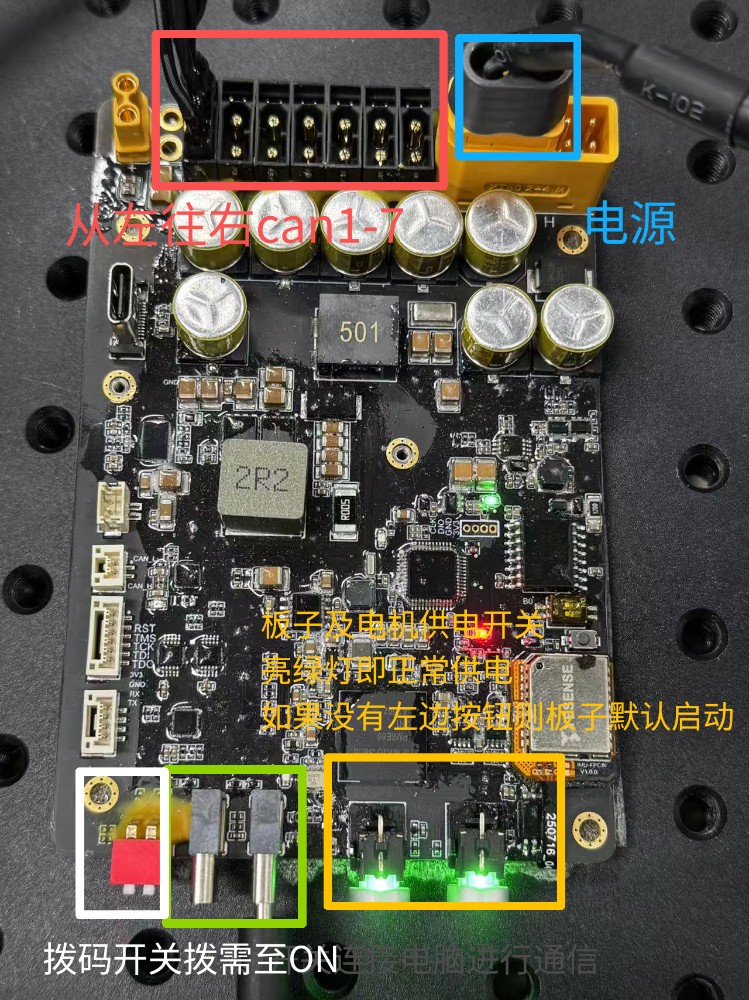
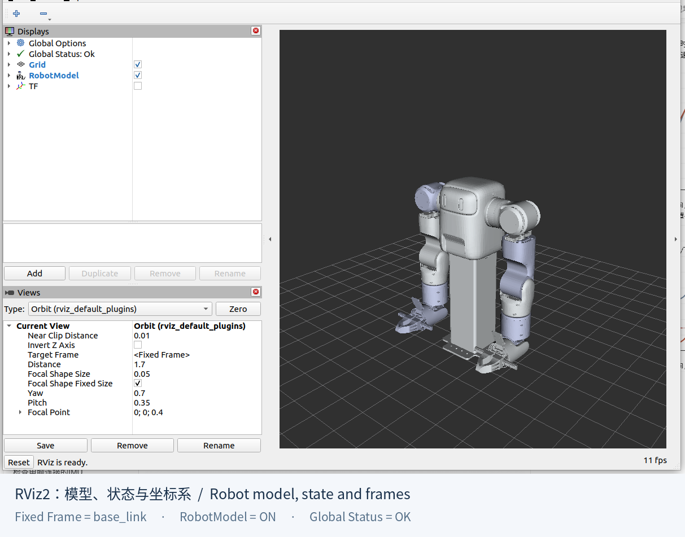
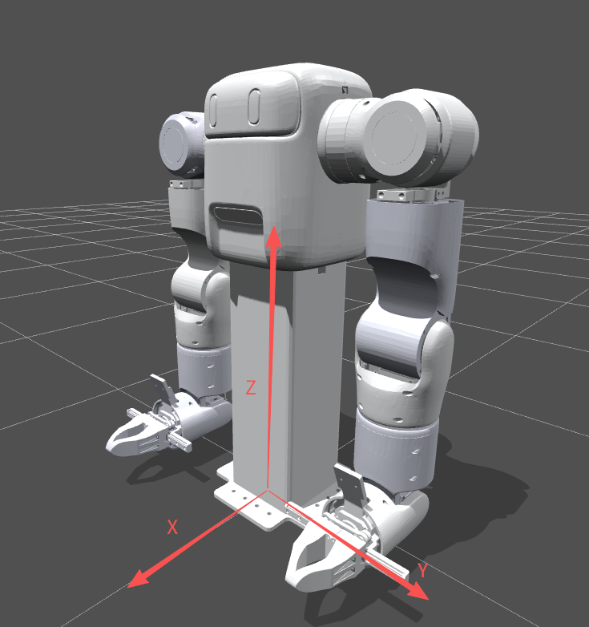
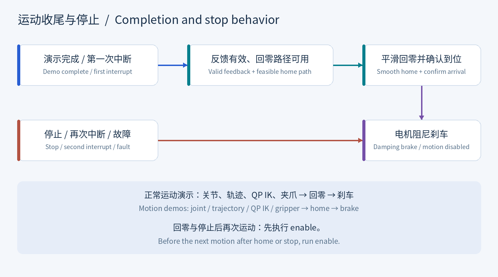
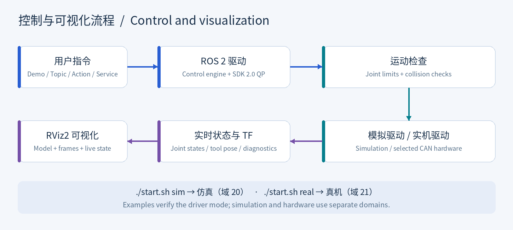

# T701-HT ROS 2 SDK

[简体中文](README.md)

This SDK provides hardware control, RViz2 visualization, joint and trajectory examples, QP inverse kinematics, gripper control, homing, and damping brake.

**Choose one operating chapter and follow its steps:**

- [Initial installation and build](#1-initial-installation-and-build): once on a new computer.
- [Hardware guide](#2-hardware-guide): all commands for the physical robot, in one place.
- [Simulation guide](#3-simulation-guide): all commands without a physical robot, in one place.
- [Interface reference](#4-interface-reference), [model and protection](#5-model-and-protection), and [project structure](#6-project-structure-and-troubleshooting): development and reference material.

Open a terminal in the **SDK root directory** containing `start.sh`. Run every command in this guide from that directory.

## 1. Initial installation and build

### 1.1 System dependencies

Use Ubuntu 22.04, ROS 2 Humble, and Python 3.10. Configure the ROS repository using the [official ROS 2 Humble installation instructions](https://docs.ros.org/en/humble/Installation/Ubuntu-Install-Debs.html), then install:

```bash
sudo apt update
sudo apt install python3-venv python3-pip python3-pytest \
  python3-colcon-common-extensions python3-numpy python3-scipy python3-yaml \
  python3-jinja2 python3-joblib \
  ros-humble-desktop ros-humble-control-msgs ros-humble-diagnostic-msgs \
  ros-humble-pinocchio ros-humble-hpp-fcl
```

`ros-humble-desktop` supplies ROS 2 and RViz2. Pinocchio and FCL provide forward kinematics, Jacobians, and mesh collision checks. Both simulation and hardware use these model libraries.

### 1.2 Create the Python environment and build

```bash
python3.10 -m venv --system-site-packages .venv
.venv/bin/python -m pip install \
  'numpy>=1.23,<2' 'scipy>=1.9,<2' 'PyYAML>=6,<7' 'osqp>=1,<2' pytest
./build.sh
```

Use the apt versions of Pinocchio/FCL with NumPy 1.x. `python_wheels/` provides some x86_64 Python 3.10 dependencies; installation also requires the system and Python dependencies above. For the motor library, see the hardware guide below.

`build.sh` and `start.sh` load ROS 2 Humble and this workspace, clear inherited Python/ROS paths, and use the SDK's `.venv`. Conda activation is unnecessary. After copying to another computer or moving the directory, recreate `.venv` and run `./build.sh` at the new location.

## 2. Hardware guide

Commands in this chapter control physical motors and use the `real` prefix. Complete the common installation, then follow this chapter to connect and operate the robot. Choose one function at a time; do not paste and run every command in the chapter as a sequence.

### 2.1 Install the motor library and connect the board

Complete this section once before using hardware.

Linux x86_64, Python 3.10:

```bash
.venv/bin/python -m pip install hardware_wheels/hightorque_robot-1.2.0-cp310-cp310-linux_x86_64.whl
```

Linux ARM64, Python 3.10:

```bash
.venv/bin/python -m pip install hardware_wheels/hightorque_robot-1.0.0-cp310-cp310-linux_aarch64.whl
```

Choose the command for the computer's architecture. See [hardware_wheels/README.md](hardware_wheels/README.md) for native-library details.



The board image identifies power, CAN, and USB communication connections.

The logical wiring is **CAN1 for the left arm** and **CAN2 for the right arm**. The driver selects serial devices by board serial number and USB interface identity, handling changes in `/dev/ttyACM*` enumeration order.

Configuration files:

```text
src/t701_ht_description/config/serial_binding.yaml
src/t701_ht_description/config/T701-HT_left.yaml
src/t701_ht_description/config/T701-HT_right.yaml
src/t701_ht_description/config/motor_param/
```

Inspect serial devices and current groups:

```bash
ls -l /dev/ttyACM*
id -nG
```

Add the current user to the serial-access group, then log out of the desktop and log in again:

```bash
sudo usermod -aG dialout "$USER"
```

Run the Python SDK and ROS 2 SDK separately. Only one program should control the same communication board at a time.

### 2.2 Terminal A: start the driver

Open terminal A in the SDK root and start both arms with RViz2:

```bash
./start.sh real arms:=dual
```

**Keep terminal A running. Open terminal B for all operations below.** Terminal B must also be in the SDK root. Hardware startup reads feedback with motion disabled.

For a single arm, close the existing driver first, then choose one of these launch commands:

Left arm:

```bash
./start.sh real arms:=left
```

Right arm:

```bash
./start.sh real arms:=right
```

Joint and trajectory examples move the arms selected by `arms`. Use `--side` to select the IK or gripper side. Dual-arm collision checking requires `arms:=dual`.

### 2.3 Terminal B: read state

**Run the state and function commands below in terminal B while terminal A stays running.**

Read state for five seconds:

```bash
./start.sh real demo --mode state --duration 5
```

Read motor position, velocity, and torque once:

```bash
./start.sh real topic echo /t701_ht/motor_states --once
```

Read tool poses and diagnostics; in single-arm mode, query only the selected side:

```bash
./start.sh real topic echo /t701_ht/left_tool_pose --once
./start.sh real topic echo /t701_ht/right_tool_pose --once
./start.sh real topic echo /diagnostics --once
```

### 2.4 Joint out-and-back motion

Move J1 on the selected arm(s) relative to the current posture, with a 0.10 rad amplitude and five-second trajectory, then return to zero and brake:

```bash
./start.sh real demo --mode enable
./start.sh real demo --mode joint --duration 5 --amplitude 0.10
```

For one arm only, launch the driver with `arms:=left` or `arms:=right` in the first terminal. With `arms:=dual`, both arms move together and the right J1 uses the opposite sign.

### 2.5 Multipoint trajectory

Run four small trajectory segments relative to the current posture over eight seconds, then return to zero and brake:

```bash
./start.sh real demo --mode enable
./start.sh real demo --mode trajectory --duration 8 --amplitude 0.10
```

`--amplitude` must be greater than zero and at most 0.20 rad. `--duration` must be positive. This duration covers the trajectory; the final homing motion has its own duration.

### 2.6 QP inverse kinematics

Left-arm demonstration:

```bash
./start.sh real demo --mode enable
./start.sh real demo --mode ik --side left
```

Right-arm demonstration:

```bash
./start.sh real demo --mode enable
./start.sh real demo --mode ik --side right
```

The demonstration creates a nearby tool-pose target from the current posture, sends the pose to the QP solver, monitors measured tool arrival, and then returns to zero and brakes. In dual-arm mode, the other arm holds its current position.

### 2.7 Gripper control

Set the left gripper to 0.4 rad:

```bash
./start.sh real demo --mode enable
./start.sh real demo --mode gripper --side left --gripper 0.4
```

Set the right gripper to 0.4 rad:

```bash
./start.sh real demo --mode enable
./start.sh real demo --mode gripper --side right --gripper 0.4
```

`--gripper` is the gripper motor angle in the range `[-0.2, 2.2]` rad. After sending the gripper target, the demonstration observes state for 5 seconds by default, then requests home. Selected arms and grippers return to zero, followed by damping brake. Set the observation time with `--duration`, for example `--duration 8`.

### 2.8 Return to zero

```bash
./start.sh real demo --mode enable
./start.sh real demo --mode home
```

Homing includes the seven joints and gripper on each arm selected by the driver. The client finishes after confirming joint arrival, low velocity, and driver mode `braked`.

### 2.9 Immediate stop

```bash
./start.sh real demo --mode stop
```

Request immediate motor damping brake and disable control. This command does not execute a homing path.

### 2.10 Interrupt and exit

Joint, trajectory, IK, and gripper examples return to zero and apply damping brake on completion. Before the next motion, enable again:

```bash
./start.sh real demo --mode enable
```

The first **Ctrl+C** in terminal B during a motion example ends that motion and requests home. The driver in terminal A continues the return and braking. To close the system, press **Ctrl+C** in terminal A; with valid feedback and a feasible return path, the driver homes, brakes, and exits. A second interruption requests immediate brake.

Direct topic commands and trajectory action goals hold the endpoint on completion. Use the homing command in this chapter when finished.

### 2.11 Visualization, headless operation, and remote use

The normal launch opens RViz2. Set Fixed Frame to `base_link`; enable **TF** for coordinate frames and **RobotModel → Collision Enabled** for collision meshes. In hardware mode, the displayed robot follows measured joint feedback.

Without a graphical desktop, start only the driver in terminal A:

```bash
./start.sh real arms:=dual rviz:=false
```

With a driver already running, open only RViz2 from a desktop terminal:

```bash
./start.sh real run rviz2 rviz2 -d src/t701_ht_ros2/config/t701_ht.rviz
```

When the driver and RViz2 run on separate computers, first allow LAN communication on both computers, then use the two commands above on the respective computers. Start only one driver:

```bash
export ROS_LOCALHOST_ONLY=0
```

Use the `real` prefix in every terminal in this chapter. The default communication domain is **21**. For GLX/OpenGL errors, close the existing driver and restart with software rendering:

```bash
T701_HT_SOFTWARE_RENDERING=1 ./start.sh real
```

### 2.12 Standard ROS commands (advanced)

For normal operation, use the examples above. Use these interfaces to connect your own programs.

<details>
<summary>Expand: joint targets, trajectory action, QP poses, grippers, and services</summary>

#### Single-arm joint target

Start a left-arm driver in the first terminal:

```bash
./start.sh real arms:=left
```

In the second terminal, send a complete seven-axis target with the default two-second smooth transition:

```bash
./start.sh real demo --mode enable
./start.sh real topic pub --once /t701_ht/joint_command sensor_msgs/msg/JointState \
  '{name: [left_joint1, left_joint2, left_joint3, left_joint4, left_joint5, left_joint6, left_joint7], position: [0.10, 0, 0, 0, 0, 0, 0]}'
```

For the right arm, launch with `arms:=right` and use names `right_joint1` through `right_joint7`.

#### Dual-arm joint target

With an `arms:=dual` driver, send a complete 14-axis target:

```bash
./start.sh real demo --mode enable
./start.sh real topic pub --once /t701_ht/joint_command sensor_msgs/msg/JointState \
  '{name: [left_joint1, left_joint2, left_joint3, left_joint4, left_joint5, left_joint6, left_joint7, right_joint1, right_joint2, right_joint3, right_joint4, right_joint5, right_joint6, right_joint7], position: [0.10, 0, 0, 0, 0, 0, 0, -0.10, 0, 0, 0, 0, 0, 0]}'
```

Names can be reordered. Each command must contain every selected joint exactly once, without extra names. The URDF names and coordinates from `/joint_states` cannot be used directly as motor commands.

#### Standard trajectory action

This example uses `arms:=left` and reaches three targets at two, four, and six seconds:

```bash
./start.sh real demo --mode enable
./start.sh real action send_goal /t701_ht/follow_joint_trajectory \
  control_msgs/action/FollowJointTrajectory \
  '{trajectory: {joint_names: [left_joint1, left_joint2, left_joint3, left_joint4, left_joint5, left_joint6, left_joint7], points: [{positions: [0.10, 0, 0, 0, 0, 0, 0], time_from_start: {sec: 2}}, {positions: [-0.10, 0, 0, 0, 0, 0, 0], time_from_start: {sec: 4}}, {positions: [0, 0, 0, 0, 0, 0, 0], time_from_start: {sec: 6}}]}}' \
  --feedback
```

Press **Ctrl+C** in the `action send_goal` terminal to send a cancellation request. The driver ends the original trajectory and requests home. Continue checking `/diagnostics` and measured state until homing and brake complete.

Trajectory requirements:

- A goal contains 1–2000 points, with a maximum total duration of 300 seconds.
- `time_from_start` increases strictly. An optional first point at zero seconds must match current state.
- Every point includes all selected joint positions. Velocities are either omitted or complete. Final velocity is zero.
- Use a zero header timestamp for immediate execution. Omit explicit accelerations, efforts, custom tolerances, and multi-DOF trajectories.
- Motion uses piecewise quintics, checking position, velocity, acceleration, and collision paths. Only one motion task executes at a time.

#### QP tool-pose target

Express targets in `base_link`. Position units are meters; quaternion order is x, y, z, w. Quaternions must be normalized, with norm error at most `1e-3`.

The following target corresponds to a left J1 position of approximately 0.06 rad from zero in the current model. Use a left-arm or dual-arm driver. Home first, enable, then publish:

```bash
./start.sh real demo --mode enable
./start.sh real demo --mode home
./start.sh real demo --mode enable
./start.sh real topic pub --once /t701_ht/left_target_pose geometry_msgs/msg/PoseStamped \
  '{header: {frame_id: base_link}, pose: {position: {x: -0.025971851, y: 0.185, z: 0.068147883}, orientation: {x: 0.0, y: 0.029995500, z: 0.0, w: 0.999550034}}}'
```

Inspect arrival with the following commands, then home as described in the homing instructions in this chapter:

```bash
./start.sh real topic echo /t701_ht/left_tool_pose --once
./start.sh real topic echo /diagnostics --once
```

Right-arm targets require right-arm coordinates; do not change only the topic of the left-arm example to `/t701_ht/right_target_pose`. For normal operation, use the right-arm IK example in this chapter. The driver constrains QP by joint position, velocity, acceleration, and geometry checks. Diagnostics report non-convergence, unreachable targets, and collision blocking.

#### Direct gripper target

```bash
./start.sh real demo --mode enable
./start.sh real topic pub --once /t701_ht/left_gripper std_msgs/msg/Float64 '{data: 0.4}'
```

For the right side, use `/t701_ht/right_gripper`. A direct topic command only sets the target. Use the gripper example in this chapter for the complete demonstration with automatic homing.

#### Home, stop, and enable services

```bash
./start.sh real service call /t701_ht/home std_srvs/srv/Trigger '{}'
./start.sh real service call /t701_ht/stop std_srvs/srv/Trigger '{}'
./start.sh real service call /t701_ht/set_enabled std_srvs/srv/SetBool '{data: true}'
./start.sh real service call /t701_ht/set_enabled std_srvs/srv/SetBool '{data: false}'
```

These are four independent operations; run the required command. A service reply of `success: true` means the request was accepted. Confirm home completion from joint position, velocity, and diagnostic `mode=braked`. Clients that wait for completion can use `demo --mode home`.

</details>

## 3. Simulation guide

Commands in this chapter operate only the kinematic simulation and use the `sim` prefix. After the common installation, no motor library or CAN board is required. Simulation is for model visualization and ROS interface practice; it does not simulate dynamics, contacts, or gravity-driven falling.

### 3.1 Preparation

Open two terminals in the SDK root: terminal A runs the driver; terminal B runs examples. Choose one function at a time instead of pasting and running the entire chapter.

### 3.2 Terminal A: start the driver

Open terminal A in the SDK root and start both arms with RViz2:

```bash
./start.sh sim arms:=dual
```

**Keep terminal A running. Open terminal B for all operations below.** Terminal B must also be in the SDK root. Simulation is running; neither the driver nor RViz2 connects to physical motors.

For a single arm, close the existing driver first, then choose one of these launch commands:

Left arm:

```bash
./start.sh sim arms:=left
```

Right arm:

```bash
./start.sh sim arms:=right
```

Joint and trajectory examples move the arms selected by `arms`. Use `--side` to select the IK or gripper side. Dual-arm collision checking requires `arms:=dual`.



### 3.3 Terminal B: read state

**Run the state and function commands below in terminal B while terminal A stays running.**

Read state for five seconds:

```bash
./start.sh sim demo --mode state --duration 5
```

Read motor position, velocity, and torque once:

```bash
./start.sh sim topic echo /t701_ht/motor_states --once
```

Read tool poses and diagnostics; in single-arm mode, query only the selected side:

```bash
./start.sh sim topic echo /t701_ht/left_tool_pose --once
./start.sh sim topic echo /t701_ht/right_tool_pose --once
./start.sh sim topic echo /diagnostics --once
```

### 3.4 Joint out-and-back motion

Move J1 on the selected arm(s) relative to the current posture, with a 0.10 rad amplitude and five-second trajectory, then return to zero and brake:

```bash
./start.sh sim demo --mode enable
./start.sh sim demo --mode joint --duration 5 --amplitude 0.10
```

For one arm only, launch the driver with `arms:=left` or `arms:=right` in the first terminal. With `arms:=dual`, both arms move together and the right J1 uses the opposite sign.

### 3.5 Multipoint trajectory

Run four small trajectory segments relative to the current posture over eight seconds, then return to zero and brake:

```bash
./start.sh sim demo --mode enable
./start.sh sim demo --mode trajectory --duration 8 --amplitude 0.10
```

`--amplitude` must be greater than zero and at most 0.20 rad. `--duration` must be positive. This duration covers the trajectory; the final homing motion has its own duration.

### 3.6 QP inverse kinematics

Left-arm demonstration:

```bash
./start.sh sim demo --mode enable
./start.sh sim demo --mode ik --side left
```

Right-arm demonstration:

```bash
./start.sh sim demo --mode enable
./start.sh sim demo --mode ik --side right
```

The demonstration creates a nearby tool-pose target from the current posture, sends the pose to the QP solver, monitors measured tool arrival, and then returns to zero and brakes. In dual-arm mode, the other arm holds its current position.

### 3.7 Gripper control

Set the left gripper to 0.4 rad:

```bash
./start.sh sim demo --mode enable
./start.sh sim demo --mode gripper --side left --gripper 0.4
```

Set the right gripper to 0.4 rad:

```bash
./start.sh sim demo --mode enable
./start.sh sim demo --mode gripper --side right --gripper 0.4
```

`--gripper` is the gripper motor angle in the range `[-0.2, 2.2]` rad. After sending the gripper target, the demonstration observes state for 5 seconds by default, then requests home. Selected arms and grippers return to zero, followed by damping brake. Set the observation time with `--duration`, for example `--duration 8`.

### 3.8 Return to zero

```bash
./start.sh sim demo --mode enable
./start.sh sim demo --mode home
```

Homing includes the seven joints and gripper on each arm selected by the driver. The client finishes after confirming joint arrival, low velocity, and driver mode `braked`.

### 3.9 Immediate stop

```bash
./start.sh sim demo --mode stop
```

Stop simulated motion, enter `braked`, and disable simulated control. This command does not execute a return path.

### 3.10 Interrupt and exit

Joint, trajectory, IK, and gripper examples return to zero and apply damping brake on completion. Before the next motion, enable again:

```bash
./start.sh sim demo --mode enable
```

The first **Ctrl+C** in terminal B during a motion example ends that motion and requests home. The driver in terminal A continues the return and braking. To close the system, press **Ctrl+C** in terminal A; with valid feedback and a feasible return path, the driver homes, brakes, and exits. A second interruption requests immediate brake.

Direct topic commands and trajectory action goals hold the endpoint on completion. Use the homing command in this chapter when finished.

### 3.11 Visualization, headless operation, and remote use

The normal launch opens RViz2. Set Fixed Frame to `base_link`; enable **TF** for coordinate frames and **RobotModel → Collision Enabled** for collision meshes. The display follows simulated joint state. Gripper fingers have no separate opening animation.

Without a graphical desktop, start only the driver in terminal A:

```bash
./start.sh sim arms:=dual rviz:=false
```

With a driver already running, open only RViz2 from a desktop terminal:

```bash
./start.sh sim run rviz2 rviz2 -d src/t701_ht_ros2/config/t701_ht.rviz
```

When the driver and RViz2 run on separate computers, first allow LAN communication on both computers, then use the two commands above on the respective computers. Start only one driver:

```bash
export ROS_LOCALHOST_ONLY=0
```

Use the `sim` prefix in every terminal in this chapter. The default communication domain is **20**. For GLX/OpenGL errors, close the existing driver and restart with software rendering:

```bash
T701_HT_SOFTWARE_RENDERING=1 ./start.sh sim
```

### 3.12 Standard ROS commands (advanced)

For normal operation, use the examples above. Use these interfaces to connect your own programs.

<details>
<summary>Expand: joint targets, trajectory action, QP poses, grippers, and services</summary>

#### Single-arm joint target

Start a left-arm driver in the first terminal:

```bash
./start.sh sim arms:=left
```

In the second terminal, send a complete seven-axis target with the default two-second smooth transition:

```bash
./start.sh sim demo --mode enable
./start.sh sim topic pub --once /t701_ht/joint_command sensor_msgs/msg/JointState \
  '{name: [left_joint1, left_joint2, left_joint3, left_joint4, left_joint5, left_joint6, left_joint7], position: [0.10, 0, 0, 0, 0, 0, 0]}'
```

For the right arm, launch with `arms:=right` and use names `right_joint1` through `right_joint7`.

#### Dual-arm joint target

With an `arms:=dual` driver, send a complete 14-axis target:

```bash
./start.sh sim demo --mode enable
./start.sh sim topic pub --once /t701_ht/joint_command sensor_msgs/msg/JointState \
  '{name: [left_joint1, left_joint2, left_joint3, left_joint4, left_joint5, left_joint6, left_joint7, right_joint1, right_joint2, right_joint3, right_joint4, right_joint5, right_joint6, right_joint7], position: [0.10, 0, 0, 0, 0, 0, 0, -0.10, 0, 0, 0, 0, 0, 0]}'
```

Names can be reordered. Each command must contain every selected joint exactly once, without extra names. The URDF names and coordinates from `/joint_states` cannot be used directly as motor commands.

#### Standard trajectory action

This example uses `arms:=left` and reaches three targets at two, four, and six seconds:

```bash
./start.sh sim demo --mode enable
./start.sh sim action send_goal /t701_ht/follow_joint_trajectory \
  control_msgs/action/FollowJointTrajectory \
  '{trajectory: {joint_names: [left_joint1, left_joint2, left_joint3, left_joint4, left_joint5, left_joint6, left_joint7], points: [{positions: [0.10, 0, 0, 0, 0, 0, 0], time_from_start: {sec: 2}}, {positions: [-0.10, 0, 0, 0, 0, 0, 0], time_from_start: {sec: 4}}, {positions: [0, 0, 0, 0, 0, 0, 0], time_from_start: {sec: 6}}]}}' \
  --feedback
```

Press **Ctrl+C** in the `action send_goal` terminal to send a cancellation request. The driver ends the original trajectory and requests home. Continue checking `/diagnostics` and measured state until homing and brake complete.

Trajectory requirements:

- A goal contains 1–2000 points, with a maximum total duration of 300 seconds.
- `time_from_start` increases strictly. An optional first point at zero seconds must match current state.
- Every point includes all selected joint positions. Velocities are either omitted or complete. Final velocity is zero.
- Use a zero header timestamp for immediate execution. Omit explicit accelerations, efforts, custom tolerances, and multi-DOF trajectories.
- Motion uses piecewise quintics, checking position, velocity, acceleration, and collision paths. Only one motion task executes at a time.

#### QP tool-pose target

Express targets in `base_link`. Position units are meters; quaternion order is x, y, z, w. Quaternions must be normalized, with norm error at most `1e-3`.

The following target corresponds to a left J1 position of approximately 0.06 rad from zero in the current model. Use a left-arm or dual-arm driver. Home first, enable, then publish:

```bash
./start.sh sim demo --mode enable
./start.sh sim demo --mode home
./start.sh sim demo --mode enable
./start.sh sim topic pub --once /t701_ht/left_target_pose geometry_msgs/msg/PoseStamped \
  '{header: {frame_id: base_link}, pose: {position: {x: -0.025971851, y: 0.185, z: 0.068147883}, orientation: {x: 0.0, y: 0.029995500, z: 0.0, w: 0.999550034}}}'
```

Inspect arrival with the following commands, then home as described in the homing instructions in this chapter:

```bash
./start.sh sim topic echo /t701_ht/left_tool_pose --once
./start.sh sim topic echo /diagnostics --once
```

Right-arm targets require right-arm coordinates; do not change only the topic of the left-arm example to `/t701_ht/right_target_pose`. For normal operation, use the right-arm IK example in this chapter. The driver constrains QP by joint position, velocity, acceleration, and geometry checks. Diagnostics report non-convergence, unreachable targets, and collision blocking.

#### Direct gripper target

```bash
./start.sh sim demo --mode enable
./start.sh sim topic pub --once /t701_ht/left_gripper std_msgs/msg/Float64 '{data: 0.4}'
```

For the right side, use `/t701_ht/right_gripper`. A direct topic command only sets the target. Use the gripper example in this chapter for the complete demonstration with automatic homing.

#### Home, stop, and enable services

```bash
./start.sh sim service call /t701_ht/home std_srvs/srv/Trigger '{}'
./start.sh sim service call /t701_ht/stop std_srvs/srv/Trigger '{}'
./start.sh sim service call /t701_ht/set_enabled std_srvs/srv/SetBool '{data: true}'
./start.sh sim service call /t701_ht/set_enabled std_srvs/srv/SetBool '{data: false}'
```

These are four independent operations; run the required command. A service reply of `success: true` means the request was accepted. Confirm home completion from joint position, velocity, and diagnostic `mode=braked`. Clients that wait for completion can use `demo --mode home`.

</details>

## 4. Interface reference

### 4.1 Interface list

| Interface | Type | Purpose |
|---|---|---|
| `/joint_states` | `sensor_msgs/msg/JointState` | URDF-coordinate state for TF/RViz2 |
| `/t701_ht/motor_states` | `sensor_msgs/msg/JointState` | SDK motor position, velocity, and torque |
| `/t701_ht/joint_command` | `sensor_msgs/msg/JointState` | Complete joint position target for selected arms |
| `/t701_ht/follow_joint_trajectory` | `control_msgs/action/FollowJointTrajectory` | Multipoint trajectories, feedback, results, and cancellation |
| `/t701_ht/left_tool_pose`, `/t701_ht/right_tool_pose` | `geometry_msgs/msg/PoseStamped` | Forward-kinematics tool poses |
| `/t701_ht/left_target_pose`, `/t701_ht/right_target_pose` | `geometry_msgs/msg/PoseStamped` | QP tool-pose targets |
| `/t701_ht/left_gripper`, `/t701_ht/right_gripper` | `std_msgs/msg/Float64` | Gripper motor position targets |
| `/t701_ht/home` | `std_srvs/srv/Trigger` | Smooth return to zero and damping brake |
| `/t701_ht/stop` | `std_srvs/srv/Trigger` | Immediate damping brake |
| `/t701_ht/set_enabled` | `std_srvs/srv/SetBool` | Enable; `false` disables and brakes |
| `/diagnostics` | `diagnostic_msgs/msg/DiagnosticArray` | Mode, enable state, active goal, errors, and collision state |

Single-arm mode creates tool and gripper interfaces only for the selected side.

### 4.2 Coordinates and example parameters

- Motor position, velocity, and torque use rad, rad/s, and N·m. Tool positions use m.
- Joint commands use `left_joint1`–`left_joint7` and `right_joint1`–`right_joint7`. Each command contains every joint selected by the driver.
- `/joint_states` uses URDF joint names and direction-adjusted coordinates for TF/RViz2. Do not feed it directly back as a motor command.
- Pose targets use `base_link` and quaternions in x, y, z, w order, with norm error at most `1e-3`.
- `--duration` is the motion time for joint/trajectory examples and the observation time for state/gripper examples. IK completes based on measured arrival rather than a requested duration.
- Joint/trajectory examples use a default amplitude of 0.10 rad. The `--amplitude` range is `(0, 0.20]` rad.
- Gripper motor limits are `[-0.2, 2.2]` rad. The gripper example observes state for 5 seconds by default, then requests home.

### 4.3 Launch arguments

| Argument | Default | Meaning |
|---|---|---|
| `arms` | `dual` | `left` / `right` / `dual` |
| `rviz` | `true` | Open RViz2 |
| `state_rate` | `50.0` | Control/state rate, 5–100 Hz |
| `enable_on_start` | `false` | Enable hardware at startup; simulation enables automatically |

Restart the driver after changing launch arguments. The entry fixes its selected backend; `simulate:=...` cannot override it. Launching with no argument defaults to simulation. Ordinary joint targets use a default transition time of 2 seconds.

Hardware and simulation use default communication domains 21 and 20. Examples verify the driver mode. Hardware connection failures are reported as errors. For multiple robots, set matching custom values in all relevant terminals. The two modes must use different integers from 0 to 232:

```bash
export T701_HT_SIM_DOMAIN_ID=30
export T701_HT_REAL_DOMAIN_ID=31
```

## 5. Model and protection

### 5.1 Model, zero posture, and QP



The image shows the model at zero. X, Y, and Z are the base coordinate axes.

The model is based on **`Origami V2总装配体_updated.urdf`**, using the SDK control model's joint-coordinate conventions.

- Physical motor zero is the all-zero joint vector. J7 limits are `[0, 3.14]` on the left and `[-3.14, 0]` rad on the right.
- The current zero includes SDK's 90° tool/gripper posture convention. The raised reference posture and physical zero are separate postures.
- Raised VR reference: left `[0.3, 0, 0, -1.87, 0, 0, pi/2]`; right uses the full negative. This reference does not change hardware zero or automatically move the arms on driver startup.
- Motor names are `left_joint1` through `left_joint7` and `right_joint1` through `right_joint7`. Position, velocity, and torque units are rad, rad/s, and N·m.
- `/joint_states` retains URDF names such as `A_l_joint1_link`, with configured direction signs applied for visualization and TF.

QP uses the same `qp_ik.py` as Python SDK, retaining joint position/velocity/acceleration constraints, redundant-posture control, singular-direction damping, and velocity smoothing. ROS call limits are 0.5 rad/s joint speed, 2 rad/s² joint acceleration, 0.10 m/s tool translation, and 0.5 rad/s angular speed. Arrival is checked using measured tool error and joint velocity.

This workspace provides native ROS 2 nodes, topics, services, and an action; its own SDK driver executes control. MoveIt, a `ros2_control` plugin, Gazebo physics simulation, and a VR input receiver are outside this package.

### 5.2 Geometry checks

Checks cover same-arm collision, arm-to-body collision, and inter-arm collision in dual-arm mode. The model uses the body and 14 arm-link collision meshes from the URDF, excluding geometry on the same rigid assembly and directly adjacent links. There are 91 dual-arm or 21 single-arm pairs, with a default 1 mm clearance margin.

Trajectories undergo curve and sampled-path checks before execution. Runtime checks cover the current-to-target segment and short predictions. Maximum joint sampling step is 0.025 rad. Collision-blocked targets are rejected and the current position is held; send another feasible target. The driver does not plan an alternate route.

Single-arm mode checks the selected arm and body, without the other arm's live state. Coverage follows the URDF. Finger opening, cables, and external obstacles are not included in collision geometry. RViz2 displays arm-link posture without finger-opening animation. Checks use discrete geometry sampling, without dynamic contact or stopping-distance calculation.

### 5.3 Completion rules



- Normal exit and the first Ctrl+C/SIGTERM: with control enabled, valid feedback, and a validated path, return smoothly to zero and apply damping brake.
- Trajectory cancellation: end the original goal and let the driver home selected joints and grippers.
- During homing, ordinary motion and gripper targets are rejected. Motion is disabled after completion.
- Explicit stop, disable, or a second interruption: request immediate damping brake.
- Invalid feedback, motor faults, tracking faults, or a stalled control cycle: enter `fault` and brake.
- A rejected home path or failure to arrive: report an error and brake, without reporting home success.

### 5.4 Hardware control gains

Hardware uses MIT position/velocity commands with gravity feedforward. J1–J7 gains:

| Gain | J1–J7 |
|---|---|
| KP | `[30, 50, 60, 25, 15, 10, 10]` |
| KD | `[3, 5, 6, 2.5, 1.5, 1, 1]` |

Gripper KP=5, KD=0.5, with a speed limit of 0.5 rad/s. One native SDK object per board sends commands for the selected arms.



## 6. Project structure and troubleshooting

### 6.1 Directory categories

The source has two ROS packages: `t701_ht_description` owns the model and device configuration; `t701_ht_ros2` owns control, communication, and examples. Simulation and hardware share motion algorithms while using separate backends and communication domains.

```text
T701_ROS2_SDK/
├── README.md / README_EN.md             User guides
├── assets/docs/                         Model, RViz, wiring, and workflow images
├── build.sh                             Build both ROS packages
├── start.sh                             sim / real startup and command entry
├── requirements.txt                     Python dependency versions
├── hardware_wheels/                     x86_64 / ARM64 native motor libraries
├── python_wheels/                       Some Python dependency packages
├── FILES_SHA256.json                     Distribution file checksums
├── VALIDATION.md                        Software acceptance record
└── src/
    ├── t701_ht_description/             Model and device configuration package
    │   ├── urdf/T701-HT.urdf          Complete robot model
    │   ├── meshes/                      15 body and arm-link STL files
    │   ├── config/
    │   │   ├── T701-HT_left.yaml        Left model, directions, and limits
    │   │   ├── T701-HT_right.yaml       Right model, directions, and limits
    │   │   ├── serial_binding.yaml      CAN board identity and USB interfaces
    │   │   └── motor_param/             Left/right motor and CAN configuration
    │   ├── source_provenance.json       Model and configuration provenance
    │   ├── CMakeLists.txt               Model resource installation rules
    │   ├── package.xml                  ROS package information and dependencies
    │   └── LICENSE                      Model package license
    └── t701_ht_ros2/                    Control and examples package
        ├── t701_ht_ros2/                Python control code
        ├── launch/                      ROS node composition and startup
        ├── config/t701_ht.rviz          Single RViz display configuration
        ├── test/                        All automated tests
        ├── resource/t701_ht_ros2        ROS package registration marker
        └── setup.py / setup.cfg / package.xml
```

### 6.2 Responsibilities of the control modules

These files are all in `src/t701_ht_ros2/t701_ht_ros2/`:

| File | Responsibility | Used for |
|---|---|---|
| `driver_node.py` | ROS topics, services, trajectory action, state publication, and control timer | Driver entry for hardware and simulation |
| `engine.py` | Quintic interpolation, task ownership, motion checks, homing, and braking | Shared execution layer for motion |
| `backend.py` | `SimBackend` updates simulated state; `SDKBackend` reads and commands physical motors | Selected by `sim` / `real` |
| `model.py` | Model loading, joint-coordinate conversion, FK, gravity, self-collision, and body-collision checks | Visualization, motion checks, and IK |
| `qp_ik.py` | Same OSQP velocity-level QP solver as Python SDK | Tool-pose inverse kinematics |
| `qp_adapter.py` | Adapts model, FK, Jacobian, and whole-robot geometry context to the seven-axis QP interface | Reuses the same solver with the ROS model |
| `serial_adapter.py` | Builds serial configuration from CAN board identity and USB interfaces | Hardware connection despite changing ACM numbers |
| `demo_node.py` | State, joint, trajectory, IK, gripper, enable, home, and stop examples | User examples through `sim demo` / `real demo` |
| `__init__.py` | Python package marker | Module imports |

Control flows as **example or ROS command → `driver_node` → `engine` → simulation or hardware `backend`**. `model` supplies kinematics and geometry checks; `qp_adapter` and `qp_ik` compute joint motion for tool targets.

### 6.3 Launch, configuration, and tests

| Location | Purpose |
|---|---|
| `launch/sdk.launch.py` | Composes the driver, TF publisher, and optional RViz2 for the `sim` / `real` entries |
| `launch/display.launch.py` | Visualization launch fixed to simulation mode |
| `config/t701_ht.rviz` | Camera, ground grid, robot model, and TF display settings |
| `test/test_backend.py` | Simulation backend, fake motor feedback, and brake logic |
| `test/test_engine.py`, `test_engine_lifecycle.py` | Trajectories, task ownership, interruption, stop, and homing |
| `test/test_model.py` | Model assets, coordinates, limits, and collision checks |
| `test/test_qp.py` | Solver provenance consistency and QP behavior |
| `test/test_ros_interfaces.py` | ROS messages, actions, and mode entry checks |
| `setup.py` | Registers the Python package, `driver` / `demo` executables, and launch resources |
| `setup.cfg` | Sets the installation location of ROS executables |
| `package.xml` | Declares the ROS package name, version, and dependencies |
| `resource/t701_ht_ros2` | Makes the Python package discoverable by ROS |

`motor_param/7dof_T701-HT_params_left.yaml` and `7dof_T701-HT_params_right.yaml` define CAN channels, motor IDs, and motor types. `T701-HT_left.yaml` and `T701-HT_right.yaml` reference those motor configurations and provide model, direction, and limit parameters. These configuration layers serve motor communication and model-based control respectively.

### 6.4 Generated build and runtime directories

| Directory | Contents | Handling |
|---|---|---|
| `.venv/` | Python dependency environment for this computer | Keep for local use; recreate on another computer |
| `build/` | colcon intermediate build files | Generated during builds |
| `install/` | Installed ROS packages, model assets, and environment entry points | Used at runtime; rebuild after moving the workspace |
| `log/` | Build and runtime logs; runtime logs are in `log/runtime/` | Inspect when diagnosing a problem |
| `__pycache__/`, `.pytest_cache/` | Python and test caches | Generated automatically and can be cleared |

A source distribution includes `src/`, images, guides, startup scripts, and dependency packages, while excluding the generated environment, build products, and caches above. The model STL files are used by both visualization and collision checks.

### 6.5 Troubleshooting

| Symptom | Action |
|---|---|
| Missing `ros2` or `rclpy` | Install ROS 2 Humble as in the initial installation instructions and use the matching mode entry in the selected operating chapter |
| `_rclpy_pybind11` or `cpython-313` error | Create `.venv` with system Python 3.10 and rebuild |
| NumPy `_ARRAY_API` error | Use NumPy `<2` in `.venv` and keep native libraries supplied by ROS apt |
| Missing `osqp` | Install `osqp>=1,<2` in `.venv` and run `./build.sh` again |
| RViz2 GLX/OpenGL error | Enable software rendering for the selected mode as in the software-rendering instructions in the selected operating chapter |
| Missing model or TF in RViz2 | Check `/robot_description`, `/joint_states`, and Fixed Frame `base_link` |
| `control is disabled` | Enable motion in the same mode as in the enable instructions in the selected operating chapter |
| Example reports a mode mismatch or no driver | Use the same `sim` / `real` prefix and communication domain for driver and example |
| Hardware startup reports motor library or serial errors | Install the matching motor library and check wiring, binding, and permissions as in the hardware guide |
| Trajectory rejected | Check names, times, fields, and limits as in the trajectory action instructions in the selected operating chapter; increase duration for excessive velocity or acceleration |
| QP does not converge | Check `base_link`, quaternion, reachability, and diagnostics; start with the QP example in the QP example in the selected operating chapter |
| Executable fails after copying | Recreate `.venv` and run `./build.sh` in the new directory |
| Topics are invisible across computers | Check mode, communication domain, LAN, and DDS configuration as in the remote visualization instructions in the selected operating chapter |
